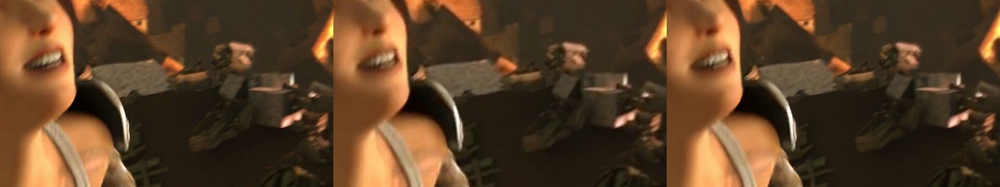

# 0.1 step 2: Does AI upscaling (VFX VSR) work in the player, on the right frame, and does it help?

- **Result:** ✅ pass (after fixing a real bug: the window showed the previous frame with VSR on)
- **Date:** 2026-11-26
- **Setup:** RTX 5080, driver 620.73.04, VFX SDK 1.3.0, KDE Plasma Wayland, 2560x1440 @ 165 Hz monitor,
  window 2048x1152, frame generation off
- **How to run:** `tests/v0.1/02-upscaling/run.sh` (~2.5 min of windows). It uses the player's test hook
  `--capture-at <seconds>`, which saves exactly the image sent to the window (no desktop screenshots).
- **Full output:** [output-2026-11-26.md](output-2026-11-26.md)

## A. Right frame (window image at 3.00 s, should be frame 72 of the 24 fps clip)

| Upscaling | PSNR vs frame 71 / **72** / 73 (dB) |
|---|---|
| off | 19.2 / **41.0** / 19.7 |
| VSR HIGH | 19.2 / **39.4** / 19.7 |

The VSR-off image also confirms the display path: the right colours, orientation and scaling (41 dB vs
FFmpeg's own decode + scale).

## B. Does it look better? (vs the real 1080p frame, PSNR dB)

| Source | Plain blit | VSR HIGH | VSR ULTRA |
|---|---|---|---|
| 540p (good encode) | 36.58 | **38.11** (+1.5) | 38.09 |
| 720p (good encode) | 36.92 | **37.74** (+0.8) | 37.77 |
| 540p (very low bitrate) | 31.79 | **32.58** (+0.8) | 32.59 |

Matches V5 (+1.4 dB at 540p). ULTRA ≈ HIGH, so HIGH stays the default.

Left to right: the real 1080p frame, the 540p version stretched by the GPU, and the 540p version upscaled
by VSR (sharper edges on the face, teeth and armour).

## C. Speed (8 s each, window 2048x1152)

| Source | VSR | ms per source frame | Output fps | Missed refreshes | Skipped |
|---|---|---|---|---|---|
| 540p | HIGH / ULTRA | 0.97 / 1.17 | 165 / 165 | 2 / 13 | 0 / 0 |
| 720p | HIGH / ULTRA | 1.31 / 1.74 | 165 / 165 | 20 / 5 | 0 / 0 |
| 1080p | HIGH / ULTRA | 2.72 / 3.62 | 165 / 165 | 1 / 21 | 0 / 0 |

VSR runs once per *source* frame (24 per second here), so even 1080p ULTRA uses ~9% of one second of GPU
time. Missed refreshes stay small and bursty (< 2% of 1320 refreshes), as in step 1.

## Bug found and fixed: the window showed the previous frame

With VSR on, the window image at 3.00 s matched frame **71**, not 72. Narrowed down outside the player
with small C++ tests:

| Variant | Output for input frame N |
|---|---|
| Blocking `NvVFX_Run` (async = 0) instead of async | still frame N-1 |
| `NvVFX_SetImage` before every run (as the Python wrapper does) | still N-1 |
| `cuCtxSynchronize()` after the run | still N-1 |
| Other formats (RGB F32 planar, BGR U8) | rejected (-7) |
| **Stream 0, or a stream created with `CU_STREAM_DEFAULT`** | **frame N** ✅ |

The VFX SDK does part of its work on CUDA's legacy default stream. Nitid's stream was
`CU_STREAM_NON_BLOCKING`, which does not wait for that work, so the result was read one frame late. **Fix:
libnitid's CUDA stream is now a blocking stream.** Side effect: earlier VSR timings in S9 (0.39 ms) were too
low for the same reason (the sync returned early). S9 was rerun and corrected (2.66 ms), and S5 got a note.
Frame generation timings were not affected.

## What this means

- Step 2 confirmed: VSR in the real player, on the right frame, visibly sharper, cheap enough for 60 fps
  sources.
- Rule for all VFX use in Nitid: **blocking CUDA stream**, and test with *changing* frames (a constant test
  image hides ordering bugs).
